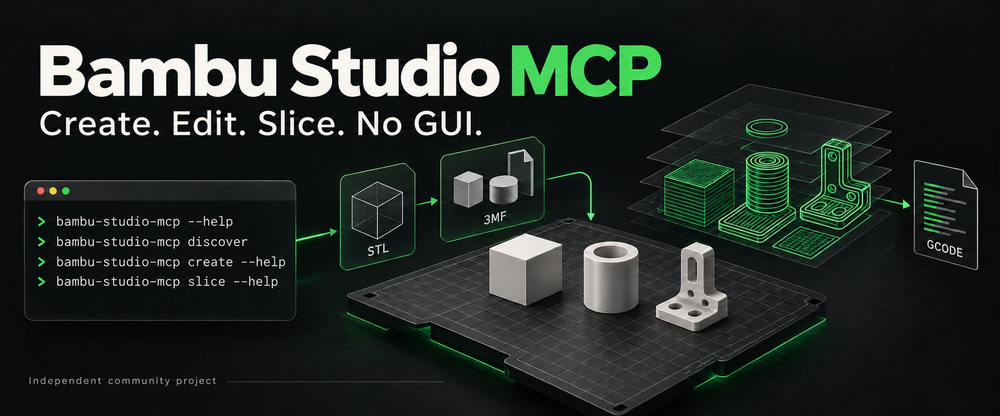
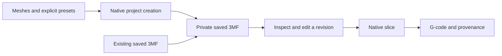

# Bambu Studio MCP · CLI first



**Create a saved 3MF from meshes, edit private revisions, and slice with your installed Bambu Studio.**

This independent community project invokes the official native Bambu Studio CLI.
It provides a small Bash launcher and an optional Python CLI, MCP server and REST
service. It does not connect to a printer or open the slicer GUI.

**Experimental Bambu implementation.** The project keeps the Snapmaker wrapper's
organization, public API declarations and compatibility types. Its document,
engine, service, persistence, settings, schema-extraction and transport execution
have been reimplemented for Bambu. See [implementation and validation scope](docs/implementation.md).
The required native suite covers ten setting effects, a regional modifier,
creation, layout, adaptive profiles and one real MCP workflow across all 35 tools.
That workflow does not cover all modes, values, printers or all 679 settings.

## Baseline and requirements

| Component | Baseline |
| --- | --- |
| Python package | `bambu-studio-mcp` 0.1.0; Python 3.11+ |
| Native engine | Separately installed official Bambu Studio, with its matching resources and libraries |
| Selected native source | Tag `v02.08.02.61`, commit `926a7192574bcb9b3a732e1ec59a46d79cb45466` in [bambulab/BambuStudio](https://github.com/bambulab/BambuStudio/tree/926a7192574bcb9b3a732e1ec59a46d79cb45466) |
| macOS bundle | `/Applications/BambuStudio.app`; another location must be selected explicitly |
| Setting catalog | 679 source-derived settings, including 122 nullable entries; source metadata is not native runtime coverage |
| Service transports | MCP over stdio or authenticated Streamable HTTP; REST on the same HTTP listener |

Basic macOS feasibility has been observed for a synthetic saved-3MF slice and
native mesh-to-3MF creation. Those observations do not certify all editing tools,
all settings, Linux/Windows native execution, GUI equivalence or physical prints.
Use the [validation workflow and limits](TEST.md) for the exact checks.

The MCP rejects generic or foreign 3MF files without the native Bambu application marker before slicing or layout. The Bambu importer otherwise treats these files as geometry and can discard their saved settings. The wrapper preserves the original metadata rather than relabeling a foreign project.

The native binary is not included in the Python package. Discovery reads known
installation locations; binding is a separate explicit action. The wrapper never
downloads, installs or silently upgrades the engine. A declared source commit is
operator-supplied provenance; executable/resource hashes are measured locally.

## Slice once

Install Bambu Studio, save a complete native Bambu Studio project, and run:

```sh
git clone https://github.com/MoraesGil/bambu-studio-mcp.git
cd bambu-studio-mcp
bash bin/bambu-slice.sh /absolute/project.3mf 1 /absolute/plate1.gcode
```

This route needs Bash and the installed app; it does not require Python or a
server. Plate numbers start at 1. The destination directory must exist and the
output filename must be new. Publication uses an exclusive hard link, so use a
filesystem that supports hard links, such as APFS. For an exFAT/FAT destination,
slice on a supported volume and copy the completed file afterward.

The default app is `/Applications/BambuStudio.app`. Select another bundle with
`BAMBU_APP="/absolute/BambuStudio.app"`. Temporary source/profile files are private
and removed on exit. Native stdout/stderr and failure status pass through.

Use the optional fourth argument `--allow-newer-file` only after checking the
file's compatibility. It bypasses the native version gate; it does not add support
for unknown features. The Bash launcher uses strict checking by default.

## Discover and bind the Python service

```sh
uv sync --frozen
uv run bambu-studio-mcp discover

uv run bambu-studio-mcp --engine /absolute/runtime/engine.json bind-engine \
  --binary /Applications/BambuStudio.app/Contents/MacOS/BambuStudio \
  --resources /Applications/BambuStudio.app/Contents/Resources \
  --commit 926a7192574bcb9b3a732e1ec59a46d79cb45466
```

Discovery reports installations without binding them. Select the build whose
source identity you have verified; do not assign the example commit to another
binary. Keep the executable in its complete app bundle. Changed engine assets
require an explicit new binding and validation.

## Create from meshes, then slice

Select printer, process and material presets explicitly. Mesh files alone do not
identify a printer or material. For a synthetic X1 Carbon example:

```sh
uv run bambu-studio-mcp --engine /absolute/runtime/engine.json \
  --artifacts /absolute/artifacts create /absolute/part.stl \
  --printer "Bambu Lab X1 Carbon 0.4 nozzle" \
  --process "0.20mm Standard @BBL X1C" \
  --filament "Generic PLA"
```

Creation accepts STL/OBJ meshes; open an existing 3MF with `load_model`.
Repeat `--filament` for additional supplied material presets. The native CLI
creates a private saved 3MF from copied meshes and temporary preset exports. The
source meshes and installed presets remain read-only. Inspect the returned
project, then use MCP `slice_project` or slice its returned path:

```sh
uv run bambu-studio-mcp --engine /absolute/runtime/engine.json \
  --artifacts /absolute/artifacts slice /absolute/created-project.3mf --plate 1
```

Replace the last input path with the actual path returned by `create`.



## MCP and REST

Start MCP over stdio:

```sh
uv run bambu-studio-mcp --engine /absolute/runtime/engine.json \
  --artifacts /absolute/artifacts serve --no-update-check
```

The service exposes project creation, inspection, revision editing, presets,
slicing and bounded output reads. Use `create_project` or `load_model`, inspect
actual object/material IDs, apply changes with the latest revision SHA, and
re-slice. Installed presets and source files are preserved.

For shared clients, authenticated Streamable HTTP exposes `/mcp` and REST
`/api/v1` on one listener. REST remains focused on slicing saved projects and
reading retained artifacts; project creation/editing use MCP or the Python API.
Client setup and examples are in [usage](docs/usage.md), [macOS setup](MACOS.md)
and [REST](docs/rest.md). [Linux/Docker](LINUX.md) is an explicitly unvalidated
native deployment recipe.

The adaptive-layer generator uses the pinned Bambu source algorithm. Native
regressions inspect actual layer Z spacing, explicit height ranges and reset.
The wrapper overlays explicit ranges after generation. Bambu-native ordinal
profile storage replaces the former wrapper-specific root-ID output; older
root-ID profiles remain readable. See [validation limits](TEST.md).

## Development and provenance

Follow [contribution-workflow.md](contribution-workflow.md). Run the public
contract suite separately from required native integration:

```sh
uv sync --frozen --extra test
uv run --frozen --extra test mypy
uv run --frozen --extra test pytest tests -q
bash -n bin/bambu-slice.sh
```

This repository starts as a separate adaptation of
[MoraesGil/snapmaker-orca-mcp](https://github.com/MoraesGil/snapmaker-orca-mcp).
No shared `slicer-mcp-core` package has been extracted. See
[architecture](docs/architecture.md), [attribution](THIRD_PARTY.md) and
[extraction provenance](EXTRACTION.json).

[GNU AGPLv3 license](LICENSE.txt)
